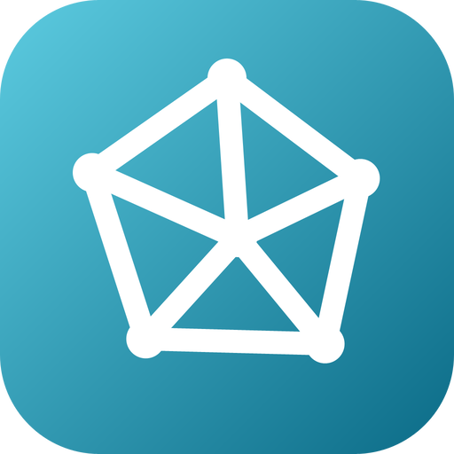

# go-geometry — brand assets

Official logos for the **go-geometry** organization.

The mark is a point set, its convex hull, and the triangulation that fans out of an interior point: the object every algorithm of the organization starts from. It is written by `mark/main.go`, which lays the points out from a short
table; nothing is placed by hand. Its gradient (`#5CCBE0` to `#0B6B87`) sets
go-geometry apart from the other go-scikit organizations; its dark end reads on
white at 6.06:1.

## Formats

- **SVG** — `svg/color`, `svg/white` (white, transparent), `svg/black` (black, transparent)
- **PNG** 16→1024 px, 3 variants — `png/<variant>/<size>/`
- **JPG** (color, white background) — `jpg/<size>/`
- **ICO** (Windows) — `ico/`
- **ICNS** (macOS) — `icns/`
- **GitHub avatar** 512 px — `avatar/`
- **Social preview** 1280×640 (repo banner) — `social/`

`check/kit.py` counts the whole matrix on every pull request, and the `mark`
job runs `mark/main.go` again and fails if `svg/color/go-geometry.svg` differs.

---
*Generated from `svg/color/go-geometry.svg` by the fleet's Go brand pipeline (brandgen) — rounded square badge, line glyph, color / white / black variants.*
